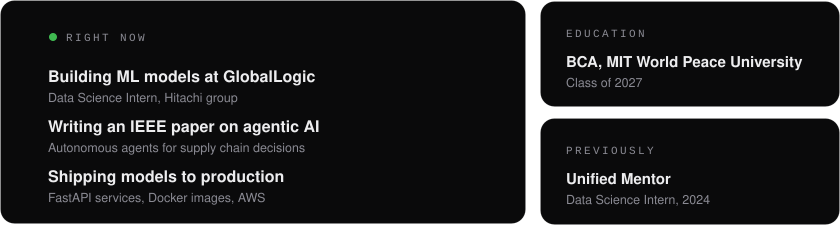
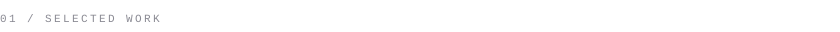
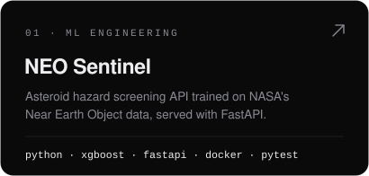
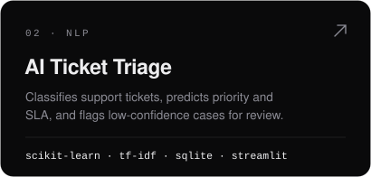
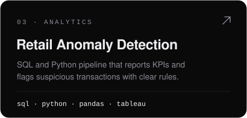
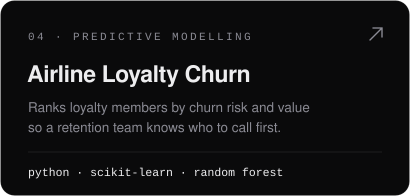
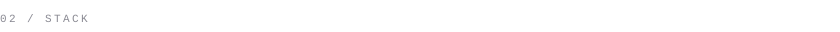
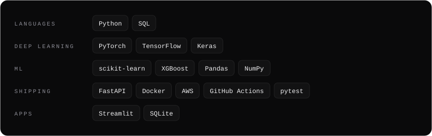

 

  
  

  
  

<a href="https://github.com/sidhantds?tab=repositories">all repositories ↗</a>

  

  &nbsp;
  &nbsp;
  

<!-- Assets are generated by scripts/render.py. Edit PROFILE there and rerun. -->
